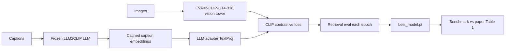
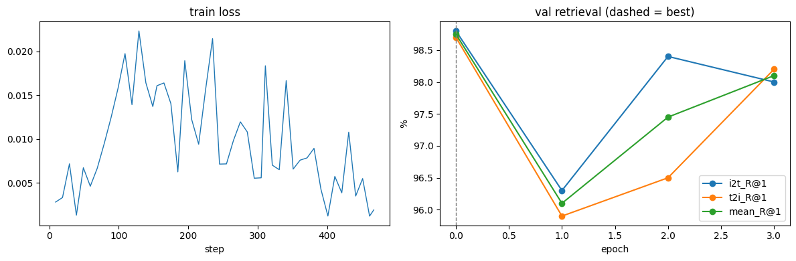
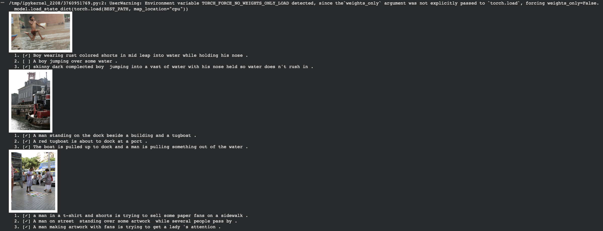

# HALO-CLIP: Fine-Tuning and Benchmarking LLM2CLIP on Google Colab

Reproduction and fine-tuning study of [LLM2CLIP](https://github.com/microsoft/LLM2CLIP) (Microsoft), which replaces CLIP's text encoder with a large language model to get richer visual representations. This repository contains single-GPU Google Colab notebooks that fine-tune LLM2CLIP on Hugging Face image-caption datasets and benchmark the result against Table 1 of the paper on **Flickr30k**, **MSCOCO** and **ShareGPT4V**.

Course project for **CSE465** (Fall 2026).

---

## Contents

- [Highlights](#highlights)
- [How It Works](#how-it-works)
- [Repository Structure](#repository-structure)
- [Notebooks](#notebooks)
- [Quick Start](#quick-start)
- [Configuration](#configuration)
- [Results](#results)
- [Known Caveats](#known-caveats)
- [Using the Fine-Tuned Checkpoint](#using-the-fine-tuned-checkpoint)
- [Acknowledgements and Citation](#acknowledgements-and-citation)

---

## Highlights

- **Fine-tuned LLM2CLIP comes within 0.2 to 0.9 points of the paper on Flickr30k**, using the 1B-parameter Llama 3.2 text encoder instead of the paper's 8B Llama 3 encoder (Flickr30k 1K test, R@1: 95.0 image-to-text, 85.2 text-to-image).
- **The released LLM2CLIP weights reproduce the paper on ShareGPT4V**, at 98.8 / 98.7 R@1 against the paper's 98.8 / 99.2.
- **Runs on one Colab GPU.** Caption embeddings are computed once with the frozen LLM and cached, so training only updates the vision tower and a small adapter. A free T4 is enough for the 1B preset.
- **Works with any Hugging Face image-caption dataset**, configured through Colab form fields with no code changes.

---

## How It Works

The notebooks follow the training recipe from the official repository (`llm2clip/run.sh` and `data/extract_embedding.py`):

1. **Embed captions once.** Every caption is encoded by Microsoft's caption-contrastive fine-tuned LLM. The LLM stays frozen, its embeddings are cached on disk, and it is then freed from GPU memory.
2. **Train the vision side.** The EVA02-CLIP-L/14-336 vision tower and the LLM adapter (`TextProj`) are trained with the CLIP contrastive loss against the cached caption embeddings.
3. **Keep the best checkpoint.** After every epoch, image-to-text and text-to-image retrieval is measured on a held-out split. The weights with the best mean R@1 are saved as `best_model.pt`.
4. **Benchmark.** The starting weights and the fine-tuned checkpoint are evaluated on the paper's test sets and printed next to Table 1.



### Model Presets

| Preset | LLM text encoder | CLIP checkpoint | Caption embedding size | GPU |
| :--- | :--- | :--- | :---: | :--- |
| `llama3.2-1b` (default) | `microsoft/LLM2CLIP-Llama-3.2-1B-Instruct-CC-Finetuned` | `microsoft/LLM2CLIP-Llama3.2-1B-EVA02-L-14-336` | 2048 | T4 16 GB works |
| `llama3-8b` (paper setting) | `microsoft/LLM2CLIP-Llama-3-8B-Instruct-CC-Finetuned` | `microsoft/LLM2CLIP-EVA02-L-14-336` | 4096 | L4 or A100 (bf16, at least 24 GB) |

Setting `INIT_FROM="eva_clip"` starts from plain EVA02-CLIP vision weights with a fresh adapter instead. That matches the paper's training from scratch, which needs far more data than these notebooks use.

### Compatibility Shims

The notebooks write a helper module, `llm2clip_utils.py`, that makes the official `eva_clip` package run on a stock Colab runtime:

- **xformers:** if xformers is not installed, `memory_efficient_attention` is routed to PyTorch's fused scaled-dot-product attention (the same computation), which avoids reinstalling a different torch build.
- **llm2vec:** the text tower import is stubbed, because training uses precomputed LLM embeddings. This avoids llm2vec's pinned `transformers` version.

---

## Repository Structure

```text
.
├── LLM2CLIP_train_colab.ipynb   # General-purpose fine-tuning notebook (any HF dataset)
├── LLM2CLIP_Flickr30k.ipynb     # Fine-tuning run on Flickr30k
├── LLM2CLIP_coco5k.ipynb        # COCO run + benchmark vs paper (Flickr30k 1K / MSCOCO 5K)
├── LLM2CLIP_SG4V.ipynb          # ShareGPT4V long-caption fine-tuning + SG4V benchmark
├── Results/
│   ├── output.md                # Full write-up of all runs: tables, logs, plots
│   ├── load_dataset.png         # Flickr30k dataset sample
│   ├── training_carve.png       # Flickr30k training loss and validation recall
│   ├── sanity_check.png         # Flickr30k caption retrieval examples
│   ├── load_dataset_coco.png    # COCO dataset sample
│   ├── lerning_carve_COCO1k.png # COCO run learning curve
│   ├── Check.png                # COCO caption retrieval examples
│   ├── SGPT4_load_dataset.png   # ShareGPT4V dataset sample
│   ├── SGPT4_lerning_carve.png  # ShareGPT4V training loss and validation recall
│   └── SGPT4_check.png          # ShareGPT4V long-caption retrieval examples
└── README.md
```

---

## Notebooks

| Notebook | Purpose | Training data | Evaluation | Open |
| :--- | :--- | :--- | :--- | :--- |
| `LLM2CLIP_train_colab.ipynb` | Template for fine-tuning on any Hugging Face dataset | Configurable (default `lmms-lab/flickr30k`) | Held-out validation split | [](https://colab.research.google.com/github/emulsazib/HALO-CLIP/blob/main/LLM2CLIP_train_colab.ipynb) |
| `LLM2CLIP_Flickr30k.ipynb` | Test 1: Flickr30k fine-tuning | 30,783 Flickr30k images | 1,000 held-out images | [](https://colab.research.google.com/github/emulsazib/HALO-CLIP/blob/main/LLM2CLIP_Flickr30k.ipynb) |
| `LLM2CLIP_coco5k.ipynb` | Test 2: COCO run and Table 1 benchmark | 4,000 MSCOCO 5K images | Flickr30k 1K test, MSCOCO 5K test | [](https://colab.research.google.com/github/emulsazib/HALO-CLIP/blob/main/LLM2CLIP_coco5k.ipynb) |
| `LLM2CLIP_SG4V.ipynb` | Test 3: ShareGPT4V long captions | 20,000 COCO images with ShareGPT4V captions | SG4V validation (1,000 images) | [](https://colab.research.google.com/github/emulsazib/HALO-CLIP/blob/main/LLM2CLIP_SG4V.ipynb) |

Every notebook has the same cell layout: configuration, install, setup, dataset loading, caption embedding, model build, data loaders, training, training curves, a retrieval sanity check, and packaging the best checkpoint for download. The COCO and SG4V notebooks add a cell that compares results with the paper.

---

## Quick Start

1. Open a notebook in Colab using one of the badges above.
2. Choose a GPU: **Runtime → Change runtime type → GPU**. A T4 is enough for the `llama3.2-1b` preset; use an L4 or A100 for `llama3-8b`.
3. Adjust the form fields in cell **1 · Configuration** if needed.
4. Set `SAVE_TO_DRIVE=True` so the caption cache, checkpoints and logs are saved to Google Drive and survive a disconnect.
5. **Runtime → Run all.**

For a fast end-to-end test, set `MAX_SAMPLES=2000` (or `NUM_TRAIN=2000` in the SG4V notebook), or set `TRAIN_LAST_N_VISION_BLOCKS=0` to train only the adapter.

The notebooks install their own dependencies (`timm`, `einops`, `ftfy`, `regex`, `peft`, `datasets`, `huggingface_hub`, plus `ijson` for SG4V) and clone the official repository into `/content/LLM2CLIP`. A Hugging Face token (`HF_TOKEN`) is optional but gives faster downloads and higher rate limits.

---

## Configuration

The main form fields in cell **1 · Configuration**:

| Field | Default | Description |
| :--- | :--- | :--- |
| `PRESET` | `llama3.2-1b` | Text encoder and CLIP checkpoint pair (see [Model Presets](#model-presets)) |
| `INIT_FROM` | `llm2clip` | Start from released LLM2CLIP weights, or from plain EVA02-CLIP (`eva_clip`) |
| `DATASET_ID` / `DATASET_CONFIG` / `DATASET_SPLIT` | `lmms-lab/flickr30k` / `""` / `test` | Hugging Face dataset to train on |
| `IMAGE_COLUMN` / `CAPTION_COLUMN` | `image` / `caption` | Column names; several caption columns can be comma-separated |
| `MAX_SAMPLES` | `0` (all rows) | Subsample the dataset for quick tests |
| `VAL_SIZE` | `1000` | Number of held-out validation images |
| `EPOCHS` | `3` | Training epochs |
| `BATCH_SIZE` | `0` (auto) | Auto picks from GPU memory: T4 32, L4 64, A100-40G 128, 80G 256 |
| `VISUAL_LR` / `TEXT_LR` | `1e-5` / `0` (auto) | Learning rates; the adapter LR is auto set to 1e-5 for `llm2clip` or 1e-4 for `eva_clip` |
| `WEIGHT_DECAY` / `VISUAL_LAYER_DECAY` | `0.05` / `0.85` | Regularization and layer-wise LR decay for the vision tower |
| `WARMUP_STEPS` / `GRAD_CLIP` | `100` / `5.0` | Cosine schedule warmup and gradient clipping |
| `TRAIN_LAST_N_VISION_BLOCKS` | `-1` | `-1` trains the whole vision tower, `0` only the head and adapter, `N` the last N blocks |
| `GRAD_CHECKPOINTING` | `True` | Lowers memory use at some speed cost |
| `RUN_NAME` | `llm2clip_flickr30k` | Name of the output folder for the cache, checkpoints and logs |
| `SAVE_TO_DRIVE` / `RESUME` | `False` / `True` | Persist to Google Drive and resume from `last_checkpoint.pt` |

Training uses AdamW (betas 0.9 / 0.98), a cosine schedule with warmup, and automatic mixed precision (bf16 on A100, fp16 with a gradient scaler otherwise).

---

## Results

The full write-up, with per-epoch tables, step-level training logs, raw console output and all plots, is in **[Results/output.md](Results/output.md)**. All experiments ran on an NVIDIA A100-SXM4-40GB.

### Benchmark vs the Paper: Flickr30k 1K and MSCOCO 5K (Table 1)

R@1 (%) on the standard Karpathy test splits.

| Method | Flickr I2T | Flickr T2I | COCO I2T | COCO T2I |
| :--- | :---: | :---: | :---: | :---: |
| Paper: CLIP ViT-L/14-336 | 87.7 | 67.0 | 58.0 | 37.1 |
| Paper: EVA02 ViT-L/14-336 | 89.6 | 78.0 | 64.2 | 47.9 |
| Paper: SigLIP ViT-L-384 | 93.7 | 81.4 | 72.0 | 53.9 |
| Paper: EVA02 ViT-L/14-336 + LLM2CLIP-60M | 95.9 | 85.4 | 72.4 | 58.8 |
| Ours: released LLM2CLIP 1B checkpoint, no fine-tuning | 93.9 | 82.3 | 67.8 | 52.9 |
| **Ours: fine-tuned `best_model.pt`** | **95.0** | **85.2** | **67.8** \* | **54.2** \* |

\* 4,000 of the 5,000 MSCOCO 5K test images were in the training data, so the fine-tuned COCO numbers are not a clean benchmark.

### Benchmark vs the Paper: ShareGPT4V (SG4V)

| Method | SG4V I2T R@1 | SG4V T2I R@1 |
| :--- | :---: | :---: |
| Paper: EVA02 ViT-L/14-336 | 91.5 | 89.4 |
| Paper: EVA02 ViT-L/14-336 + LLM2CLIP-60M | 98.8 | 99.2 |
| **Ours: released LLM2CLIP 8B checkpoint, no fine-tuning** | **98.8** | **98.7** |
| Ours: after 3 epochs of fine-tuning | 98.0 | 98.2 |

### Summary of Training Runs

| Test | Notebook | Training images | Best checkpoint | Mean R@1 (validation) | Time per epoch |
| :--- | :--- | :---: | :--- | :---: | :---: |
| 1. Flickr30k | `LLM2CLIP_Flickr30k.ipynb` | 30,783 | Epoch 3 | 89.87 (from 88.12) | 11.2 min |
| 2. COCO | `LLM2CLIP_coco5k.ipynb` | 4,000 | Resumed Flickr30k checkpoint | 89.87 | - |
| 3. ShareGPT4V | `LLM2CLIP_SG4V.ipynb` | 20,000 | Epoch 0 (pre-trained weights) | 98.75 | 7.4 to 10.0 min |

### Training Curves

| Flickr30k | ShareGPT4V |
| :---: | :---: |
|  |  |

Left plot in each image: training loss per step. Right plot: validation R@1 per epoch, with a dashed line at the best epoch.

### Retrieval Examples



*Top-3 captions retrieved for Flickr30k validation images by the fine-tuned model. `[✓]` marks a ground-truth caption.*

---

## Known Caveats

- **The COCO run resumed a Flickr30k checkpoint.** `RUN_NAME` was still `llm2clip_flickr30k`, so the notebook printed `Resumed after epoch 3` instead of training on COCO from the start, and its learning curve is identical to the Flickr30k one. Use a distinct `RUN_NAME` for each experiment.
- **COCO test overlap.** MSCOCO 5K is only 5,000 images, so training on 4,000 of them leaks into the benchmark. Use it for evaluation only, as the configuration comment in `LLM2CLIP_coco5k.ipynb` advises.
- **The SG4V validation set differs from the paper's.** The paper's SG4V-1K is the first 1,000 entries of `share-captioner_coco_lcs_sam_1246k_1107.json`, which are all SAM/LCS images. These notebooks download only the COCO images, so validation uses the first 1,000 COCO entries instead.
- **Smaller text encoder.** The Flickr30k and COCO runs use the 1B Llama 3.2 encoder, while the paper's rows use the 8B Llama 3 encoder, so a gap to the paper is expected.
- **Saturated starting point.** On SG4V the released weights already score about 98.8 R@1, and three epochs of fine-tuning on 20,000 images did not improve on them.

---

## Using the Fine-Tuned Checkpoint

The last cell of each notebook packages `best_model.pt`, `llm2clip_utils.py`, the run configuration and a `load_model.py` example into a zip and downloads it. To use it locally:

```bash
git clone https://github.com/microsoft/LLM2CLIP
pip install torch torchvision timm einops ftfy regex transformers huggingface_hub pillow
```

Then unzip the package, keep `llm2clip_utils.py` next to `load_model.py`, and run `load_model.py`. `best_model.pt` uses the same format as Microsoft's released `.pt` files, so it also loads with the official repository's `model.load_state_dict(torch.load(...))`.

---

## Acknowledgements and Citation

This project builds on the official [microsoft/LLM2CLIP](https://github.com/microsoft/LLM2CLIP) code and pre-trained models. The datasets come from Hugging Face: [lmms-lab/flickr30k](https://huggingface.co/datasets/lmms-lab/flickr30k), [nlphuji/flickr_1k_test_image_text_retrieval](https://huggingface.co/datasets/nlphuji/flickr_1k_test_image_text_retrieval), [nlphuji/mscoco_2014_5k_test_image_text_retrieval](https://huggingface.co/datasets/nlphuji/mscoco_2014_5k_test_image_text_retrieval) and [Lin-Chen/ShareGPT4V](https://huggingface.co/datasets/Lin-Chen/ShareGPT4V).

If you use this work, please cite the original paper:

```bibtex
@article{huang2024llm2clip,
  title   = {LLM2CLIP: Powerful Language Model Unlocks Richer Visual Representation},
  author  = {Huang, Weiquan and Wu, Aoqi and Yang, Yifan and Luo, Xufang and Yang, Yuqing and Hu, Liang and Dai, Qi and Dai, Xiyang and Chen, Dongdong and Luo, Chong and Qiu, Lili},
  journal = {arXiv preprint arXiv:2411.04997},
  year    = {2024}
}
```
