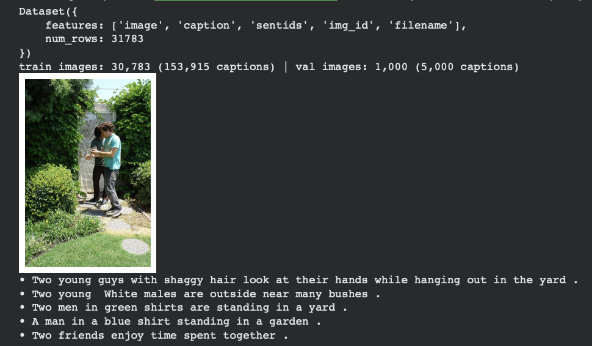
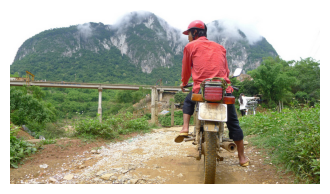
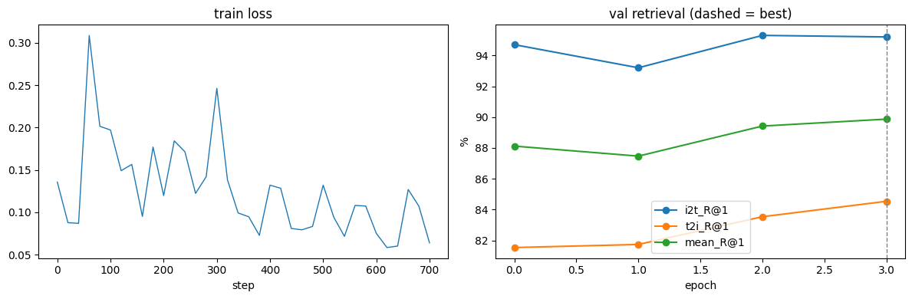
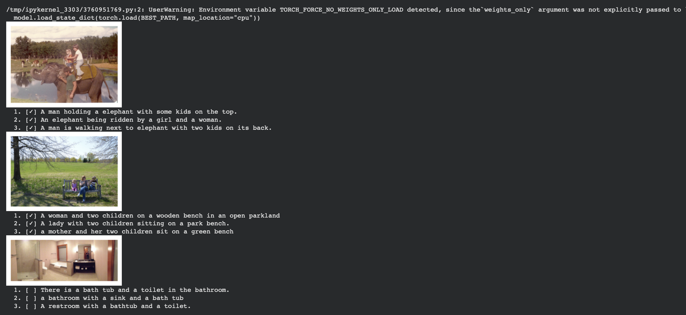
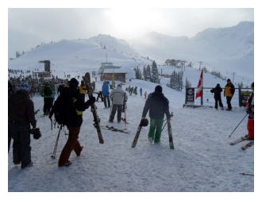
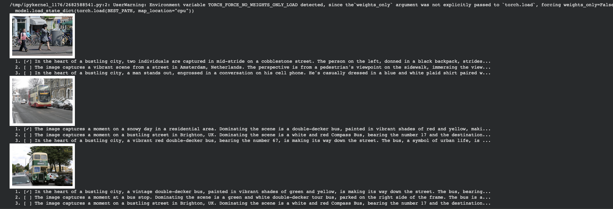

# LLM2CLIP Fine-Tuning Results

Image-text retrieval experiments with LLM2CLIP (frozen LLM caption embeddings + trainable EVA02 vision tower and adapter), run in Google Colab on Flickr30k, COCO and ShareGPT4V.

**Contents**

- [Results at a Glance](#results-at-a-glance)
- [Test 1: Flickr30k](#test-1-flickr30k)
- [Test 2: COCO 1k](#test-2-coco-1k)
- [Test 3: ShareGPT4V (SG4V-1K)](#test-3-sharegpt4v-sg4v-1k)
- [Comparison with the Paper](#comparison-with-the-paper)
  - [Flickr30k 1K and MSCOCO 5K (Table 1)](#flickr30k-1k-and-mscoco-5k-table-1)
  - [ShareGPT4V SG4V-1K](#sharegpt4v-sg4v-1k)

---

## Results at a Glance

All numbers are retrieval recall (%) from the best checkpoint of each run.

| Test | Training data | Evaluation set | CLIP model | Checkpoint | I2T R@1 | T2I R@1 | Mean R@1 | Rsum |
| :--- | :--- | :--- | :--- | :---: | :---: | :---: | :---: | :---: |
| 1 | Flickr30k (30,783 images) | Flickr30k val (1,000 images) | Llama3.2-1B-EVA02-L-14-336 | epoch 3 | 95.2 | 84.5 | **89.87** | 574.3 |
| 2 | COCO (4,000 images), resumed checkpoint | MSCOCO 5K test | Llama3.2-1B-EVA02-L-14-336 | `best_model.pt` | 67.8 | 54.2 | **61.0** | 468.0 |
| 2 | (same checkpoint) | Flickr30k 1K test | Llama3.2-1B-EVA02-L-14-336 | `best_model.pt` | 95.0 | 85.2 | **90.1** | 576.4 |
| 3 | ShareGPT4V (20,000 COCO images) | SG4V val (1,000 images) | EVA02-CLIP-L-14-336 | epoch 0 (no fine-tune) | 98.8 | 98.7 | **98.75** | 597.1 |

> **Note on Test 2:** the run resumed an existing checkpoint (`Resumed after epoch 3 (best mean R@1 89.87)`) from the `llm2clip_flickr30k` output folder rather than training from scratch. The benchmark notebook also warns that 4,000 of the 5,000 MSCOCO 5K test images were in the training data, so the fine-tuned COCO numbers are not a clean benchmark.

---

## Test 1: Flickr30k

### Setup

| Item | Value |
| :--- | :--- |
| Dataset | Flickr30k (Hugging Face), 31,783 images |
| Split | Train: 30,783 images (153,915 captions), Val: 1,000 images (5,000 captions) |
| Caption encoder | LLM2CLIP LLM (frozen, cached), 2048-d embeddings |
| Caption embedding time | 158,915 captions in 76 s |
| CLIP model | `LLM2CLIP-Llama3.2-1B-EVA02-L-14-336.pt` |
| Parameters | 375M total, 375M trainable (vision 305M, adapter 70M) |

### Dataset Preview



*A training image with its five reference captions.*

### Epoch Evaluations

| Epoch | I2T R@1 / 5 / 10 | T2I R@1 / 5 / 10 | Mean R@1 | Train Loss | Duration |
| :--- | :---: | :---: | :---: | :---: | :---: |
| 0 (before training) | 94.7 / 99.5 / 99.8 | 81.5 / 95.5 / 97.7 | 88.12 | - | - |
| 1/3 | 93.2 / 99.3 / 99.8 | 81.7 / 96.1 / 98.0 | 87.47 | 0.161 | 11.2 min |
| 2/3 | 95.3 / 99.5 / 99.7 | 83.5 / 96.7 / 98.2 | 89.42 | 0.138 | 11.2 min |
| **3/3** | **95.2 / 99.4 / 99.7** | **84.5 / 97.0 / 98.5** | **89.87** | **0.101** | 11.2 min |

**Best: epoch 3, mean R@1 89.87, rsum 574.3.** Fine-tuning raised mean R@1 by 1.75 points over the starting weights, mostly from text-to-image retrieval (T2I R@1 81.5 to 84.5).

### Learning Curve


*Left: training loss per step. Right: validation R@1 per epoch (dashed line marks the best epoch).*

### Sanity Check: Caption Retrieval with the Best Weights


*Top-3 retrieved captions for validation images. `[✓]` marks a ground-truth caption.*

<details>
<summary><b>Raw console log (Test 1)</b></summary>

```text
Warning: You are sending unauthenticated requests to the HF Hub. Please set a HF_TOKEN to enable higher rate limits and faster downloads.
README.md: 100% 2.23k/2.23k [00:00<00:00, 269kB/s]
data/test-00000-of-00009.parquet: 100%  471MB /  471MB, 43.0MB/s
data/test-00001-of-00009.parquet: 100%  475MB /  475MB, 44.9MB/s
data/test-00002-of-00009.parquet: 100%  486MB /  486MB, 20.4MB/s
data/test-00003-of-00009.parquet: 100%  472MB /  472MB, 44.9MB/s
data/test-00004-of-00009.parquet: 100%  490MB /  490MB, 46.5MB/s
data/test-00005-of-00009.parquet: 100%  500MB /  500MB, 45.1MB/s
data/test-00006-of-00009.parquet: 100%  528MB /  528MB, 50.0MB/s
data/test-00007-of-00009.parquet: 100%  511MB /  511MB, 48.5MB/s
data/test-00008-of-00009.parquet: 100%  477MB /  477MB, 45.0MB/s
Generating test split: 100% 31783/31783 [00:10<00:00, 3690.12 examples/s]
Dataset({
    features: ['image', 'caption', 'sentids', 'img_id', 'filename'],
    num_rows: 31783
})
train images: 30,783 (153,915 captions) | val images: 1,000 (5,000 captions)
  • Two young guys with shaggy hair look at their hands while hanging out in the yard .
  • Two young  White males are outside near many bushes .
  • Two men in green shirts are standing in a yard .
  • A man in a blue shirt standing in a garden .
  • Two friends enjoy time spent together .

# Embed captions with the LLM2CLIP LLM (frozen, cached)
model.safetensors: 100% 4.94GB / 4.94GB, 283MB/s
Loading weights: 100% 146/146 [00:00<00:00, 571.81it/s]
LLM caption embeddings: 100% 1203/1203 [01:13<00:00, 24.50it/s]
LLM caption embeddings: 100% 40/40 [00:02<00:00, 20.73it/s]
Embedded 158,915 captions in 76s
train_emb (153915, 2048) | val_emb (5000, 2048)

# Build the CLIP model (repo's eva_clip) and load weights from Hugging Face
LLM2CLIP-Llama3.2-1B-EVA02-L-14-336.pt: 100%  750MB /  750MB, 65.6MB/s
Loaded all weights from LLM2CLIP-Llama3.2-1B-EVA02-L-14-336.pt
Llama3.2-1B-EVA02-L-14-336: 375M params, 375M trainable (vision 305M, adapter 70M)

# Training
epoch 0 | i2t R@1/5/10 94.7/99.5/99.8 | t2i R@1/5/10 81.5/95.5/97.7 | mean R@1 88.12 (before training)
  ★ new best → /content/drive/MyDrive/llm2clip_runs/llm2clip_flickr30k/best_model.pt
epoch 1/3: 100% 240/240 [11:05<00:00, 2.75s/it, i2t=0.94, loss=0.184, scale=99.9]
epoch 1 | i2t R@1/5/10 93.2/99.3/99.8 | t2i R@1/5/10 81.7/96.1/98.0 | mean R@1 87.47 | train loss 0.161 | 11.2 min
epoch 2/3: 100% 240/240 [11:04<00:00, 2.75s/it, i2t=0.98, loss=0.079, scale=99.9]
epoch 2 | i2t R@1/5/10 95.3/99.5/99.7 | t2i R@1/5/10 83.5/96.7/98.2 | mean R@1 89.42 | train loss 0.138 | 11.2 min
  ★ new best → /content/drive/MyDrive/llm2clip_runs/llm2clip_flickr30k/best_model.pt
epoch 3/3: 100% 240/240 [11:04<00:00, 2.75s/it, i2t=0.98, loss=0.064, scale=99.9]
epoch 3 | i2t R@1/5/10 95.2/99.4/99.7 | t2i R@1/5/10 84.5/97.0/98.5 | mean R@1 89.87 | train loss 0.101 | 11.2 min
  ★ new best → /content/drive/MyDrive/llm2clip_runs/llm2clip_flickr30k/best_model.pt

Best: epoch 3 | mean R@1 89.87 | rsum 574.3
```

</details>

---

## Test 2: COCO 1k

### Setup

| Item | Value |
| :--- | :--- |
| GPU | NVIDIA A100-SXM4-40GB (42 GB), AMP `torch.bfloat16`, SDPA attention (no xformers) |
| Batch size / LR | 128 / visual LR 1e-5, adapter LR 1e-5 |
| Dataset | `nlphuji/mscoco_2014_5k_test_image_text_retrieval`, 5,000 images |
| Split | Train: 4,000 images (20,000 captions), Val: 1,000 images (5,000 captions) |
| Caption encoder | LLM2CLIP LLM (frozen), 2048-d embeddings, 25,000 captions in 12 s |
| CLIP model | `LLM2CLIP-Llama3.2-1B-EVA02-L-14-336.pt`, 375M params (vision 305M, adapter 70M) |
| Output directory | `/content/drive/MyDrive/llm2clip_runs/llm2clip_flickr30k` |

### Dataset Preview



*Reference captions for this image:*

- A man with a red helmet on a small moped on a dirt road.
- Man riding a motor bike on a dirt road on the countryside.
- A man riding on the back of a motorcycle.
- A dirt path with a young person on a motor bike rests to the foreground of a verdant area with a bridge and a background of cloud-wreathed mountains.
- A man in a red shirt and a red hat is on a motorcycle on a hill side.

### Training

Training did not start fresh: because the output directory still pointed at the Flickr30k run, the notebook resumed that checkpoint.

```text
Resumed after epoch 3 (best mean R@1 89.87)
Best: epoch 3 | mean R@1 89.87 | rsum 574.3
```

### Learning Curve



*This plot is byte-for-byte identical to the Flickr30k curve, since it comes from the resumed Flickr30k run history.*

### Sanity Check: Caption Retrieval on COCO



*Top-3 retrieved captions per image. The first two images retrieve all three ground-truth captions. The bathroom image retrieves relevant captions, but none of them are its ground-truth captions.*

### Benchmark Evaluation (Flickr30k 1K and MSCOCO 5K)

Both the released LLM2CLIP checkpoint and the fine-tuned `best_model.pt` were evaluated on the standard Karpathy test splits used in Table 1 of the paper.

| Benchmark | Images | Captions | Source |
| :--- | :---: | :---: | :--- |
| Flickr30k 1K test | 1,000 | 5,000 | `nlphuji/flickr_1k_test_image_text_retrieval` |
| MSCOCO 5K test | 5,000 | 25,010 | `nlphuji/mscoco_2014_5k_test_image_text_retrieval` (cached copy) |

**Full recall at K (%)**

| Model | Benchmark | I2T R@1 | T2I R@1 | I2T R@5 | T2I R@5 | I2T R@10 | T2I R@10 | Mean R@1 |
| :--- | :--- | :---: | :---: | :---: | :---: | :---: | :---: | :---: |
| Released (no fine-tune) | Flickr30k 1K | 93.9 | 82.3 | 99.3 | 95.9 | 99.7 | 98.0 | 88.1 |
| Released (no fine-tune) | MSCOCO 5K | 67.8 | 52.9 | 87.2 | 77.4 | 92.3 | 85.0 | 60.4 |
| **Fine-tuned `best_model.pt`** | **Flickr30k 1K** | **95.0** | **85.2** | **99.7** | **97.6** | **99.8** | **99.1** | **90.1** |
| **Fine-tuned `best_model.pt`** | **MSCOCO 5K** | **67.8** | **54.2** | **88.3** | **78.6** | **93.0** | **86.1** | **61.0** |

**Effect of fine-tuning (R@1 change vs the released checkpoint)**

| Benchmark | I2T R@1 | T2I R@1 | Mean R@1 |
| :--- | :---: | :---: | :---: |
| Flickr30k 1K | +1.1 | +2.9 | +2.0 |
| MSCOCO 5K | +0.0 | +1.3 | +0.6 |

Fine-tuning helps text-to-image retrieval on both benchmarks. On Flickr30k it closes most of the gap to the paper's best EVA02 result (see [the comparison table](#flickr30k-1k-and-mscoco-5k-table-1)). COCO image-to-text R@1 is unchanged.

> **Caution:** 4,000 of the 5,000 MSCOCO 5K test images were in the training data, so the fine-tuned COCO numbers are not a clean benchmark. The released-checkpoint COCO numbers are unaffected.

<details>
<summary><b>Raw console log (Test 2)</b></summary>

```text
FutureWarning: Importing from timm.models.layers is deprecated, please import via timm.layers
Please 'pip install apex'
GPU: NVIDIA A100-SXM4-40GB (42 GB) | AMP: torch.bfloat16 | xformers: False (SDPA fallback otherwise)
Batch size 128 | visual LR 1e-05 | adapter LR 1e-05
Mounted at /content/drive
Outputs → /content/drive/MyDrive/llm2clip_runs/llm2clip_flickr30k

README.md: 100% 641/641 [00:00<00:00, 62.1kB/s]
Warning: You are sending unauthenticated requests to the HF Hub. Please set a HF_TOKEN to enable higher rate limits and faster downloads.
(…)oco_2014_5k_test_image_text_retrieval.py: 100% 2.90k/2.90k [00:00<00:00, 354kB/s]
TEST/test/0000.parquet: 100%  510MB /  510MB, 22.9MB/s
TEST/test/0001.parquet: 100%  311MB /  311MB, 25.6MB/s
Generating test split: 5000/0 [00:01<00:00, 4226.31 examples/s]
Dataset({
    features: ['image', 'caption', 'sentids', 'imgid', 'split', 'cocoid', 'filename', 'filepath', 'tokens', 'sentid'],
    num_rows: 5000
})
train images: 4,000 (20,000 captions) | val images: 1,000 (5,000 captions)

model.safetensors: 100% 4.94GB / 4.94GB, 264MB/s
Loading weights: 100% 146/146 [00:00<00:00, 555.92it/s]
LLM caption embeddings: 100% 157/157 [00:10<00:00, 21.84it/s]
LLM caption embeddings: 100% 40/40 [00:02<00:00, 20.29it/s]
Embedded 25,000 captions in 12s
train_emb (20000, 2048) | val_emb (5000, 2048)

LLM2CLIP-Llama3.2-1B-EVA02-L-14-336.pt: 100%  750MB /  750MB, 67.8MB/s
Loaded all weights from LLM2CLIP-Llama3.2-1B-EVA02-L-14-336.pt
Llama3.2-1B-EVA02-L-14-336: 375M params, 375M trainable (vision 305M, adapter 70M)

Resumed after epoch 3 (best mean R@1 89.87)
Best: epoch 3 | mean R@1 89.87 | rsum 574.3

README.md: 100% | 754/754 [00:00<00:00, 91.7kB/s]
flickr_1k_test_image_text_retrieval.py: 100% | 2.79k/2.79k [00:00<00:00, 350kB/s]
TEST/test/0000.parquet: 100% | 142MB / 142MB, 13.5MB/s
Generating test split: 1000/0 [00:00<00:00, 4260.38 examples/s]
Using the latest cached version of the dataset since nlphuji/mscoco_2014_5k_test_image_text_retrieval couldn't be found on the Hugging Face Hub

Flickr: 1,000 images, 5,000 captions (nlphuji/flickr_1k_test_image_text_retrieval)
COCO: 5,000 images, 25,010 captions (nlphuji/mscoco_2014_5k_test_image_text_retrieval)

Loading weights: 100% | 146/146 [00:00<00:00, 561.66it/s]
LLM caption embeddings: 100% | 40/40 [00:02<00:00, 20.40it/s]
LLM caption embeddings: 100% | 196/196 [00:11<00:00, 20.92it/s]
Loaded all weights from LLM2CLIP-Llama3.2-1B-EVA02-L-14-336.pt
UserWarning: Environment variable TORCH_FORCE_NO_WEIGHTS_ONLY_LOAD detected, since the `weights_only` argument was not explicitly passed to `torch.load`, forcing weights_only=False.
  model.load_state_dict(torch.load(BEST_PATH, map_location="cpu"))

R@1 (%). Flickr = Flickr30k 1K test, COCO = MSCOCO 5K test (Karpathy splits), as in Table 1.
Text encoder: microsoft/LLM2CLIP-Llama-3.2-1B-Instruct-CC-Finetuned. The paper's rows use its own (Llama-3-8B-based) text encoder.
⚠️ COCO: 4000 of 5000 test images were in your training data, so the fine-tuned COCO numbers are not a clean benchmark.

                                                                            i2t_R@1  t2i_R@1  i2t_R@5  t2i_R@5  i2t_R@10  t2i_R@10  mean_R@1
Ours: LLM2CLIP-Llama3.2-1B-EVA02-L-14-336 (released, no fine-tune)  Flickr     93.9     82.3     99.3     95.9      99.7      98.0      88.1
                                                                    COCO       67.8     52.9     87.2     77.4      92.3      85.0      60.4
Ours: fine-tuned best_model.pt (mscoco_2014_5k_test_image_text_retrieval)
                                                                    Flickr     95.0     85.2     99.7     97.6      99.8      99.1      90.1
                                                                    COCO       67.8     54.2     88.3     78.6      93.0      86.1      61.0

Saved: /content/drive/MyDrive/llm2clip_runs/llm2clip_flickr30k/benchmark_vs_paper.md
```

</details>

---

## Test 3: ShareGPT4V (SG4V-1K)

### Setup

| Item | Value |
| :--- | :--- |
| Annotations | `share-captioner_coco_lcs_sam_1246k_1107.json` (1.49 GB, 591,486 entries) |
| Images | 21,000 COCO images downloaded (0 failures, ~96 img/s, 3m37s) |
| Split | Train: 20,000 images, Val: 1,000 images (1 long caption each) |
| Average caption length | 145 words |
| Caption encoder | `microsoft/LLM2CLIP-Llama-3-8B-Instruct-CC-Finetuned` (frozen), 4096-d embeddings |
| Caption embedding time | 21,000 captions in 5m29s |
| CLIP model | `LLM2CLIP-EVA02-L-14-336.pt` |
| Parameters | 579M total, 579M trainable (vision 305M, adapter 274M) |
| Throughput / memory | ~46 img/s, 25.4 GB GPU memory |

### Dataset Preview



*Excerpt of the long-form ShareGPT4V caption for this image:*

> The image captures a lively scene at a ski resort on a snowy day. The sky above is a clear blue, providing a beautiful contrast to the white snow below. The resort is bustling with people, all dressed in winter clothing and carrying ski equipment, ready to enjoy the day on the slopes.
>
> In the center of the image, a group of people can be seen walking towards a ski lift, their ski equipment in hand. The ski lift, a prominent feature in the image, is located on the right side of the frame. It stands tall against the backdrop of the snow-covered mountains, ready to transport skiers to the top of ...

### Epoch Evaluations

| Epoch | I2T R@1 / 5 / 10 | T2I R@1 / 5 / 10 | Mean R@1 | Train Loss | Duration |
| :--- | :---: | :---: | :---: | :---: | :---: |
| **0 (before training)** | **98.8 / 99.9 / 100.0** | **98.7 / 99.8 / 99.9** | **98.75** | - | - |
| 1/3 | 96.3 / 99.8 / 99.9 | 95.9 / 99.6 / 99.9 | 96.10 | 0.0107 | 7.4 min |
| 2/3 | 98.4 / 99.9 / 99.9 | 96.5 / 99.8 / 99.9 | 97.45 | 0.0118 | 7.4 min |
| 3/3 | 98.0 / 99.9 / 99.9 | 98.2 / 99.9 / 99.9 | 98.10 | 0.0063 | 10.0 min |

**Best: epoch 0 (pre-trained weights), mean R@1 98.75, rsum 597.1.** Saved to `/content/drive/MyDrive/llm2clip_runs/llm2clip_sg4v/best_model.pt`.

The pre-trained LLM2CLIP weights are already near the ceiling on this split. Fine-tuning dropped mean R@1 to 96.10 after epoch 1 and recovered to 98.10 by epoch 3, without beating the starting point.

### Learning Curve


*Left: training loss per step. Right: validation R@1 per epoch (dashed line marks the best epoch, epoch 0).*

### Sanity Check: Long-Caption Retrieval



*Top-3 retrieved long captions per image. The ground-truth caption (`[✓]`) is ranked first for all three images.*

<details>
<summary><b>Step-by-step training logs (Test 3)</b></summary>

#### Epoch 1/3

| Step | Progress | Loss | I2T Acc | T2I Acc | LR | Scale | GNorm | Img/s | Mem | Elapsed | ETA |
| :--- | :--- | :--- | :--- | :--- | :--- | :--- | :--- | :--- | :--- | :--- | :--- |
| 10/156 | 6% | 0.0028 | 1.00 | 1.00 | 1.10e-06 | 100.0 | 1.46 | 42.8 | 25.4GB | 0:00:29 | 0:22:51 |
| 20/156 | 13% | 0.0033 | 1.00 | 1.00 | 2.10e-06 | 100.0 | 0.12 | 46.1 | 25.4GB | 0:00:57 | 0:21:32 |
| 30/156 | 19% | 0.0072 | 1.00 | 1.00 | 3.10e-06 | 100.0 | 3.80 | 46.1 | 25.4GB | 0:01:25 | 0:20:47 |
| 40/156 | 26% | 0.0013 | 1.00 | 1.00 | 4.10e-06 | 100.0 | 0.25 | 46.1 | 25.4GB | 0:01:53 | 0:20:11 |
| 50/156 | 32% | 0.0067 | 1.00 | 1.00 | 5.10e-06 | 100.0 | 0.01 | 46.1 | 25.4GB | 0:02:20 | 0:19:38 |
| 60/156 | 38% | 0.0046 | 1.00 | 1.00 | 6.10e-06 | 100.0 | 3.75 | 46.1 | 25.4GB | 0:02:48 | 0:19:07 |
| 70/156 | 45% | 0.0067 | 1.00 | 1.00 | 7.10e-06 | 100.0 | 0.24 | 46.1 | 25.4GB | 0:03:16 | 0:18:36 |
| 80/156 | 51% | 0.0095 | 1.00 | 0.99 | 8.10e-06 | 100.0 | 2.93 | 46.1 | 25.4GB | 0:03:44 | 0:18:07 |
| 90/156 | 58% | 0.0125 | 0.99 | 1.00 | 9.10e-06 | 100.0 | 0.10 | 46.1 | 25.4GB | 0:04:11 | 0:17:38 |
| 100/156 | 64% | 0.0158 | 1.00 | 0.99 | 1.00e-05 | 100.0 | 4.71 | 46.1 | 25.4GB | 0:04:39 | 0:17:09 |
| 110/156 | 71% | 0.0198 | 1.00 | 0.99 | 9.98e-06 | 100.0 | 4.33 | 46.1 | 25.4GB | 0:05:07 | 0:16:40 |
| 120/156 | 77% | 0.0139 | 1.00 | 0.99 | 9.93e-06 | 100.0 | 2.84 | 46.1 | 25.4GB | 0:05:35 | 0:16:12 |
| 130/156 | 83% | 0.0223 | 1.00 | 0.99 | 9.84e-06 | 100.0 | 6.16 | 46.1 | 25.4GB | 0:06:02 | 0:15:43 |
| 140/156 | 90% | 0.0164 | 1.00 | 0.99 | 9.71e-06 | 100.0 | 0.19 | 46.1 | 25.4GB | 0:06:30 | 0:15:15 |
| 150/156 | 96% | 0.0137 | 1.00 | 0.99 | 9.55e-06 | 100.0 | 2.11 | 46.1 | 25.4GB | 0:06:58 | 0:14:47 |
| 156/156 | 100% | 0.0161 | 1.00 | 0.99 | 9.44e-06 | 100.0 | 0.75 | 46.1 | 25.4GB | 0:07:15 | 0:14:30 |

#### Epoch 2/3

| Step | Progress | Loss | I2T Acc | T2I Acc | LR | Scale | GNorm | Img/s | Mem | Elapsed | ETA |
| :--- | :--- | :--- | :--- | :--- | :--- | :--- | :--- | :--- | :--- | :--- | :--- |
| 10/156 | 6% | 0.0164 | 1.00 | 0.99 | 9.23e-06 | 100.0 | 0.17 | 44.2 | 25.4GB | 0:08:10 | 0:14:52 |
| 20/156 | 13% | 0.0140 | 1.00 | 0.99 | 8.98e-06 | 99.9 | 6.50 | 46.1 | 25.4GB | 0:08:38 | 0:14:19 |
| 30/156 | 19% | 0.0063 | 1.00 | 1.00 | 8.71e-06 | 99.9 | 4.62 | 46.1 | 25.4GB | 0:09:05 | 0:13:47 |
| 40/156 | 26% | 0.0189 | 1.00 | 0.99 | 8.41e-06 | 99.9 | 5.71 | 46.1 | 25.4GB | 0:09:33 | 0:13:16 |
| 50/156 | 32% | 0.0122 | 1.00 | 0.99 | 8.09e-06 | 99.9 | 2.93 | 46.1 | 25.4GB | 0:10:01 | 0:12:44 |
| 60/156 | 38% | 0.0094 | 1.00 | 0.99 | 7.74e-06 | 99.9 | 6.23 | 46.1 | 25.4GB | 0:10:29 | 0:12:13 |
| 70/156 | 45% | 0.0157 | 1.00 | 0.99 | 7.38e-06 | 99.9 | 1.82 | 46.1 | 25.4GB | 0:10:56 | 0:11:43 |
| 80/156 | 51% | 0.0215 | 1.00 | 0.99 | 6.99e-06 | 99.9 | 4.12 | 46.1 | 25.4GB | 0:11:24 | 0:11:13 |
| 90/156 | 58% | 0.0071 | 1.00 | 1.00 | 6.59e-06 | 99.9 | 5.97 | 46.1 | 25.4GB | 0:11:52 | 0:10:42 |
| 100/156 | 64% | 0.0072 | 1.00 | 1.00 | 6.18e-06 | 99.9 | 1.03 | 46.1 | 25.4GB | 0:12:20 | 0:10:12 |
| 110/156 | 71% | 0.0098 | 1.00 | 0.99 | 5.77e-06 | 99.9 | 4.44 | 46.1 | 25.4GB | 0:12:47 | 0:09:43 |
| 120/156 | 77% | 0.0120 | 1.00 | 1.00 | 5.34e-06 | 99.9 | 5.83 | 46.1 | 25.4GB | 0:13:15 | 0:09:13 |
| 130/156 | 83% | 0.0108 | 1.00 | 0.99 | 4.91e-06 | 99.9 | 3.22 | 46.1 | 25.4GB | 0:13:43 | 0:08:43 |
| 140/156 | 90% | 0.0055 | 1.00 | 1.00 | 4.49e-06 | 99.9 | 0.41 | 46.1 | 25.4GB | 0:14:11 | 0:08:14 |
| 150/156 | 96% | 0.0056 | 1.00 | 1.00 | 4.07e-06 | 99.9 | 0.10 | 46.1 | 25.4GB | 0:14:38 | 0:07:45 |
| 156/156 | 100% | 0.0184 | 1.00 | 0.99 | 3.82e-06 | 99.9 | 3.82 | 46.1 | 25.4GB | 0:14:55 | 0:07:27 |

#### Epoch 3/3

| Step | Progress | Loss | I2T Acc | T2I Acc | LR | Scale | GNorm | Img/s | Mem | Elapsed | ETA |
| :--- | :--- | :--- | :--- | :--- | :--- | :--- | :--- | :--- | :--- | :--- | :--- |
| 10/156 | 6% | 0.0070 | 1.00 | 0.99 | 3.41e-06 | 99.9 | 0.52 | 44.2 | 25.4GB | 0:15:50 | 0:07:11 |
| 20/156 | 13% | 0.0065 | 1.00 | 1.00 | 3.01e-06 | 99.9 | 0.72 | 46.1 | 25.4GB | 0:16:18 | 0:06:40 |
| 30/156 | 19% | 0.0167 | 1.00 | 0.99 | 2.62e-06 | 99.9 | 2.53 | 46.1 | 25.4GB | 0:19:22 | 0:07:08 |
| 40/156 | 26% | 0.0066 | 1.00 | 1.00 | 2.26e-06 | 99.9 | 2.28 | 46.1 | 25.4GB | 0:19:49 | 0:06:32 |
| 50/156 | 32% | 0.0076 | 1.00 | 1.00 | 1.91e-06 | 99.9 | 1.55 | 46.1 | 25.4GB | 0:20:17 | 0:05:56 |
| 60/156 | 38% | 0.0079 | 1.00 | 1.00 | 1.59e-06 | 99.9 | 0.07 | 46.1 | 25.4GB | 0:20:45 | 0:05:21 |
| 70/156 | 45% | 0.0089 | 1.00 | 1.00 | 1.29e-06 | 99.9 | 2.31 | 46.1 | 25.4GB | 0:21:13 | 0:04:46 |
| 80/156 | 51% | 0.0043 | 1.00 | 1.00 | 1.02e-06 | 99.9 | 3.46 | 46.1 | 25.4GB | 0:21:41 | 0:04:12 |
| 90/156 | 58% | 0.0012 | 1.00 | 1.00 | 7.73e-07 | 99.9 | 0.09 | 46.1 | 25.4GB | 0:22:08 | 0:03:38 |
| 100/156 | 64% | 0.0057 | 1.00 | 1.00 | 5.61e-07 | 99.9 | 0.29 | 46.1 | 25.4GB | 0:22:36 | 0:03:04 |
| 110/156 | 71% | 0.0039 | 1.00 | 1.00 | 3.81e-07 | 99.9 | 0.86 | 46.1 | 25.4GB | 0:23:04 | 0:02:30 |
| 120/156 | 77% | 0.0108 | 1.00 | 0.99 | 2.34e-07 | 99.9 | 3.35 | 46.1 | 25.4GB | 0:23:32 | 0:01:57 |
| 130/156 | 83% | 0.0035 | 1.00 | 1.00 | 1.23e-07 | 99.9 | 0.82 | 46.1 | 25.4GB | 0:23:59 | 0:01:24 |
| 140/156 | 90% | 0.0055 | 1.00 | 1.00 | 4.66e-08 | 99.9 | 3.83 | 46.1 | 25.4GB | 0:24:27 | 0:00:51 |
| 150/156 | 96% | 0.0012 | 1.00 | 1.00 | 6.56e-09 | 99.9 | 0.08 | 46.1 | 25.4GB | 0:24:55 | 0:00:19 |
| 156/156 | 100% | 0.0019 | 1.00 | 1.00 | 0.00e+00 | 99.9 | 0.42 | 46.1 | 25.4GB | 0:25:11 | 0:00:00 |

</details>

<details>
<summary><b>Raw console log (Test 3)</b></summary>

```text
Warning: You are sending unauthenticated requests to the HF Hub. Please set a HF_TOKEN to enable higher rate limits and faster downloads.
share-captioner_coco_lcs_sam_1246k_1107.json: 100% 1.49GB / 1.49GB, 104MB/s
read 591,486 entries | COCO collected 21,000/21,000
paper's SG4V-1K (first 1000 entries) by source: {'sam': 1000}
  images  1,000/21,000 | failed 0 | 82.3 img/s | 0:00:12
  images  5,000/21,000 | failed 0 | 93.7 img/s | 0:00:53
  images 10,000/21,000 | failed 0 | 95.1 img/s | 0:01:45
  images 15,000/21,000 | failed 0 | 96.0 img/s | 0:02:36
  images 20,000/21,000 | failed 0 | 96.2 img/s | 0:03:27
  images 21,000/21,000 | failed 0 | 96.4 img/s | 0:03:37
train images: 20,000 | val images: 1,000 (1 long caption each)
average caption length: 145 words

config.json: 100% 835/835 [00:00<00:00, 111kB/s]
tokenizer_config.json: 100% 51.0k/51.0k [00:00<00:00, 159kB/s]
tokenizer.json: 100% 9.09M/9.09M [00:00<00:00, 129MB/s]
special_tokens_map.json: 100% 335/335 [00:00<00:00, 41.8kB/s]
model.safetensors.index.json: 100% 22.2k/22.2k [00:00<00:00, 2.80MB/s]
Download complete: 12.9GB, 206MB/s
Reconstruction complete: 100% 15.0GB / 15.0GB, 617MB/s
Fetching 4 files: 100% 4/4 [00:42<00:00, 24.71s/it]
Loading weights: 100% 290/290 [00:00<00:00, 3685.09it/s]
LLM caption embeddings: 100% 329/329 [05:29<00:00, 1.84it/s]
embedded 21,000 captions in 0:05:29
train_emb (20000, 4096) | val_emb (1000, 4096)

LLM2CLIP-EVA02-L-14-336.pt: 100% 1.16GB / 1.16GB, 94.5MB/s
Loaded all weights from LLM2CLIP-EVA02-L-14-336.pt
EVA02-CLIP-L-14-336: 579M params, 579M trainable (vision 305M, adapter 274M)
==============================================================================================================
epoch 0 (before training) | I2T R@1/5/10 98.8/99.9/100.0 | T2I R@1/5/10 98.7/99.8/99.9 | mean R@1 98.75
  * new best (mean R@1 98.75) -> /content/drive/MyDrive/llm2clip_runs/llm2clip_sg4v/best_model.pt
==============================================================================================================
epoch 1/3 done | I2T R@1/5/10 96.3/99.8/99.9 | T2I R@1/5/10 95.9/99.6/99.9 | mean R@1 96.10 | train loss 0.0107 | 7.4 min
epoch 2/3 done | I2T R@1/5/10 98.4/99.9/99.9 | T2I R@1/5/10 96.5/99.8/99.9 | mean R@1 97.45 | train loss 0.0118 | 7.4 min
epoch 3/3 done | I2T R@1/5/10 98.0/99.9/99.9 | T2I R@1/5/10 98.2/99.9/99.9 | mean R@1 98.10 | train loss 0.0063 | 10.0 min
--------------------------------------------------------------------------------------------------------------
Best: epoch 0 | mean R@1 98.75 | rsum 597.1
```

</details>

---

## Comparison with the Paper

### Flickr30k 1K and MSCOCO 5K (Table 1)

R@1 (%) on the Flickr30k 1K and MSCOCO 5K Karpathy test splits, matching Table 1 of the paper. The Δ rows compare against the paper's best EVA02 result (EVA02 ViT-L/14-336 + LLM2CLIP-60M).

| Method | Flickr I2T | Flickr T2I | COCO I2T | COCO T2I |
| :--- | :---: | :---: | :---: | :---: |
| Paper: CLIP ViT-L/14-336 | 87.7 | 67.0 | 58.0 | 37.1 |
| Paper: CLIP ViT-L/14-336 + LLM2CLIP-15M | 91.2 | 82.1 | 65.5 | 53.6 |
| Paper: CLIP ViT-L/14-336 + LLM2CLIP-60M | 93.9 | 84.3 | 68.5 | 54.8 |
| Paper: EVA02 ViT-L/14-336 | 89.6 | 78.0 | 64.2 | 47.9 |
| Paper: EVA02 ViT-L/14-336 + LLM2CLIP-15M | 94.7 | 85.1 | 69.7 | 58.5 |
| Paper: EVA02 ViT-L/14-336 + LLM2CLIP-60M | 95.9 | 85.4 | 72.4 | 58.8 |
| Paper: SigLIP ViT-L-384 | 93.7 | 81.4 | 72.0 | 53.9 |
| Ours: LLM2CLIP-Llama3.2-1B-EVA02-L-14-336 (released, no fine-tune) | 93.9 | 82.3 | 67.8 | 52.9 |
| *Δ vs paper EVA02 + LLM2CLIP-60M* | *-2.0* | *-3.1* | *-4.6* | *-5.9* |
| **Ours: fine-tuned `best_model.pt`** | **95.0** | **85.2** | **67.8** | **54.2** |
| *Δ vs paper EVA02 + LLM2CLIP-60M* | *-0.9* | *-0.2* | *-4.6* | *-4.6* |

**Evaluation notes**

- **Text encoder:** `microsoft/LLM2CLIP-Llama-3.2-1B-Instruct-CC-Finetuned` (1B parameters). The paper's rows use its own Llama-3-8B-based text encoder, so a gap is expected.
- **Flickr30k:** the fine-tuned model comes within 0.9 (I2T) and 0.2 (T2I) points of the paper's best EVA02 result, and beats the paper's SigLIP and CLIP + LLM2CLIP rows.
- **MSCOCO:** 4,000 of the 5,000 test images were in the training data, so the fine-tuned COCO numbers are not a clean benchmark. Even so, the model stays 4.6 points below the paper on both directions.
- **Saved table:** `/content/drive/MyDrive/llm2clip_runs/llm2clip_flickr30k/benchmark_vs_paper.md`

### ShareGPT4V SG4V-1K

R@1 (%) on the SG4V validation set.

| Method | SG4V I2T R@1 | SG4V T2I R@1 |
| :--- | :---: | :---: |
| Paper: CLIP ViT-L/14-336 | 86.2 | 84.0 |
| Paper: CLIP ViT-L/14-336 + LLM2CLIP-15M | 98.1 | 98.4 |
| Paper: CLIP ViT-L/14-336 + LLM2CLIP-60M | 98.9 | 99.1 |
| Paper: EVA02 ViT-L/14-336 | 91.5 | 89.4 |
| Paper: EVA02 ViT-L/14-336 + LLM2CLIP-15M | 98.8 | 99.2 |
| Paper: EVA02 ViT-L/14-336 + LLM2CLIP-60M | 98.8 | 99.2 |
| Paper: SigLIP ViT-L-384 | 90.1 | 90.4 |
| **Ours: start (LLM2CLIP, no fine-tune)** | **98.8** | **98.7** |
| Ours: after 3 epochs of fine-tuning | 98.0 | 98.2 |
| *Δ (ours, start) vs paper EVA02 + LLM2CLIP-60M* | *+0.0* | *-0.5* |

**Evaluation notes**

- **Validation set:** the first 1,000 COCO entries of `share-captioner_coco_lcs_sam_1246k_1107.json`. The paper's SG4V-1K is the first 1,000 entries of the same file, but those are all SAM/LCS images (0 of 1,000 are COCO), which were not downloaded here. The two validation sets therefore contain different images.
- **Text encoder:** `microsoft/LLM2CLIP-Llama-3-8B-Instruct-CC-Finetuned`. The paper's rows also use its Llama-3-8B text encoder.
- **Training data:** 20,000 COCO images, with validation images excluded.
